# PMS database structure

Schema `pms` (PostgreSQL). This file is generated from the JPA entities in `pms-db/src/main/java/com/sentrifugo/db/entity` and is therefore the same structure Hibernate creates (`spring.jpa.hibernate.ddl-auto=update`). There is no Flyway or Liquibase: new columns and tables are added automatically on startup, existing ones are never dropped or rewritten.

Written for: backend and database engineers working on PMS_Java.

**33 tables.** Every table also has the six common columns below (inherited from `BaseEntity`), which are not repeated per table.

## Common columns (every table)

| Column | Type | Null | Notes |
|---|---|---|---|
| `id` | uuid | NO | Primary key, assigned by the application |
| `created_by` | varchar(255) | YES | IAM user id that created the row |
| `modified_by` | varchar(255) | YES | IAM user id that last changed the row |
| `created_date` | timestamp | YES | Set when the row is created |
| `modified_date` | timestamp | YES | Set when the row is changed |
| `is_active` | boolean | NO | Soft-delete flag, default true |

Ids are UUIDs. Organisation, user, plant, department and designation ids are **IAM ids stored as plain strings** (no foreign key): the IAM data lives in another service. Every business table is scoped by `organisation_id` either directly or through its parent.

## References that are not foreign keys

These uuid columns point at another PMS table but carry no database constraint; the service layer keeps them consistent.

| Column | Refers to |
|---|---|
| `pms_cycle.rating_scale_id` | `rating_scale.id` |
| `pms_cycle.approval_workflow_id` | `approval_workflow.id` |
| `goal_assignment.template_id` | `goal_template.id` (the template the sheet was set against) |
| `goal_assignment.change_kpi_id` | `kpi_master.id` (the KPI of the employee's open change request) |
| `goal_sheet_history.kpi_id` | `kpi_master.id` (null for sheet-level steps) |
| `appraisal_line.ref_id` | `kpi_master.id` for KRA lines, `competency_master.id` for competency lines (see `line_type`) |
| `user_notification.cycle_id` | `pms_cycle.id` |

## Tables by area

| Area | Tables |
|---|---|
| Appraisal cycle | `pms_cycle`, `pms_cycle_stage`, `pms_cycle_applicability`, `pms_cycle_plant`, `pms_cycle_department`, `pms_cycle_employment_type`, `pms_cycle_eligibility_run`, `pms_cycle_notification` |
| Masters and rating scales | `kra_master`, `kpi_master`, `competency_master`, `standard_rating_level`, `rating_scale`, `rating_scale_level` |
| Goal templates | `goal_template`, `goal_template_kra`, `goal_template_kpi`, `goal_template_competency` |
| Goal setting (manager, employee, HOD) | `goal_assignment`, `goal_assignment_target`, `goal_change_request`, `goal_sheet_history`, `goal_transfer`, `goal_transfer_kra` |
| Progress, mid-year review and target revision | `goal_progress`, `mid_year_review`, `target_revision`, `target_revision_row` |
| Appraisal, calibration and workflow | `appraisal`, `appraisal_line`, `calibration_distribution`, `approval_workflow` |
| Notifications | `user_notification` |

## Relationships (foreign keys)

```mermaid
erDiagram
    appraisal ||--o{ appraisal_line : "appraisal_id"
    competency_master ||--o{ goal_template_competency : "competency_id"
    goal_assignment ||--o{ appraisal : "assignment_id"
    goal_assignment ||--o{ goal_assignment_target : "assignment_id"
    goal_assignment ||--o{ goal_change_request : "assignment_id"
    goal_assignment ||--o{ goal_progress : "assignment_id"
    goal_assignment ||--o{ goal_sheet_history : "assignment_id"
    goal_assignment ||--o{ mid_year_review : "assignment_id"
    goal_assignment ||--o{ target_revision : "assignment_id"
    goal_template ||--o{ goal_template_competency : "template_id"
    goal_template ||--o{ goal_template_kpi : "template_id"
    goal_template ||--o{ goal_template_kra : "template_id"
    goal_transfer ||--o{ goal_transfer_kra : "transfer_id"
    kpi_master ||--o{ goal_assignment_target : "kpi_id"
    kpi_master ||--o{ goal_change_request : "kpi_id"
    kpi_master ||--o{ goal_progress : "kpi_id"
    kpi_master ||--o{ goal_template_kpi : "kpi_id"
    kpi_master ||--o{ target_revision_row : "kpi_id"
    kra_master ||--o{ goal_template_kpi : "kra_id"
    kra_master ||--o{ goal_template_kra : "kra_id"
    kra_master ||--o{ kpi_master : "kra_id"
    pms_cycle ||--o{ pms_cycle_applicability : "cycle_id"
    pms_cycle ||--o{ pms_cycle_department : "cycle_id"
    pms_cycle ||--o{ pms_cycle_eligibility_run : "cycle_id"
    pms_cycle ||--o{ pms_cycle_employment_type : "cycle_id"
    pms_cycle ||--o{ pms_cycle_notification : "cycle_id"
    pms_cycle ||--o{ pms_cycle_plant : "cycle_id"
    pms_cycle ||--o{ pms_cycle_stage : "cycle_id"
    rating_scale ||--o{ rating_scale_level : "rating_scale_id"
    target_revision ||--o{ target_revision_row : "revision_id"
```

## Appraisal cycle

### `pms.pms_cycle`

| Column | Type | Null | Notes |
|---|---|---|---|
| `organisation_id` | varchar(255) | NO |  |
| `cycle_code` | varchar(30) | NO | Unique |
| `name` | varchar(200) | NO |  |
| `description` | text | YES |  |
| `type` | varchar(20) | NO | Values: `ANNUAL`, `MID_YEAR`, `CUSTOM` |
| `period_start` | date | NO |  |
| `period_end` | date | NO |  |
| `status` | varchar(20) | NO | Values: `DRAFT`, `ACTIVE`, `CLOSED`, `CANCELLED` |
| `rating_scale_id` | uuid | YES |  |
| `notify_managers` | boolean | NO |  |
| `notify_employees` | boolean | NO |  |
| `notify_hod` | boolean | NO |  |
| `notify_hr` | boolean | NO |  |
| `notify_gp` | boolean | NO | Screen 1.5 "Notify GP". The columns above map to Section Heads, Employees, Functional Heads and Plant Heads / Plant HR. Default: boolean default false not null |
| `approval_workflow_id` | uuid | YES | The approval workflow chosen on screen 1.5; null when none was picked. |
| `current_step` | integer | NO |  |
| `completed_step` | integer | NO |  |
| `published_on` | timestamp | YES |  |

**Indexes:** `organisation_id` (idx_pms_cycle_org); `status` (idx_pms_cycle_status); `type` (idx_pms_cycle_type); `period_start` (idx_pms_cycle_period_start); `created_date` (idx_pms_cycle_created_date); `rating_scale_id` (idx_pms_cycle_rating_scale)

### `pms.pms_cycle_stage`

Screen 1.3 - one timeline row per stage of a cycle.

| Column | Type | Null | Notes |
|---|---|---|---|
| `cycle_id` | uuid | NO | FK to `pms_cycle` |
| `stage` | varchar(60) | NO | Values: `GOAL_SETTING`, `EMPLOYEE_ACKNOWLEDGEMENT`, `HOD_APPROVAL`, `PROGRESS_TRACKING`, `MID_YEAR_REVIEW`, `SELF_APPRAISAL`, `MANAGER_APPRAISAL`, `HOD_REVIEW`, `HR_COMPETENCY_RATING`, `CALIBRATION_FINAL_APPROVAL`, `APPROVAL_PUBLISH` |
| `start_date` | date | YES |  |
| `end_date` | date | YES |  |
| `notification_enabled` | boolean | NO |  |

**Unique:** `cycle_id, stage` (uk_pms_cycle_stage_cycle_stage)

**Indexes:** `cycle_id` (idx_pms_cycle_stage_cycle); `stage` (idx_pms_cycle_stage_stage)

### `pms.pms_cycle_applicability`

Screen 1.4 - who a cycle covers (one row per cycle). Plants, departments and employment types are child tables.

| Column | Type | Null | Notes |
|---|---|---|---|
| `cycle_id` | uuid | NO | FK to `pms_cycle` |
| `all_plants` | boolean | NO |  |
| `all_departments` | boolean | NO |  |
| `minimum_service_months` | integer | YES |  |
| `appraisal_minimum_service_months` | integer | YES | Minimum service for the appraisal half; `minimum_service_months` is the goal-setting half. |
| `service_calculated_as_on` | date | YES | The appraisal rule: service must be complete on or before this date. |
| `exclude_probation` | boolean | NO |  |
| `exclude_notice_period` | boolean | NO |  |

### `pms.pms_cycle_plant`

Screen 1.4 - a plant a cycle applies to. The plant master lives in the existing Sentrifugo system; only its id is stored.

| Column | Type | Null | Notes |
|---|---|---|---|
| `cycle_id` | uuid | NO | FK to `pms_cycle` |
| `plant_id` | varchar(255) | NO |  |

**Unique:** `cycle_id, plant_id` (uk_pms_cycle_plant_cycle_plant)

**Indexes:** `cycle_id` (idx_pms_cycle_plant_cycle); `plant_id` (idx_pms_cycle_plant_plant)

### `pms.pms_cycle_department`

Screen 1.4 - a department a cycle applies to. The department master lives in the existing Sentrifugo system.

| Column | Type | Null | Notes |
|---|---|---|---|
| `cycle_id` | uuid | NO | FK to `pms_cycle` |
| `department_id` | varchar(255) | NO |  |

**Unique:** `cycle_id, department_id` (uk_pms_cycle_department_cycle_dept)

**Indexes:** `cycle_id` (idx_pms_cycle_department_cycle); `department_id` (idx_pms_cycle_department_dept)

### `pms.pms_cycle_employment_type`

Screen 1.4 - an employment type a cycle applies to, for goal setting or for the appraisal.

| Column | Type | Null | Notes |
|---|---|---|---|
| `cycle_id` | uuid | NO | FK to `pms_cycle` |
| `scope` | varchar(20) | NO | Values: `GOAL_SETTING`, `APPRAISAL` |
| `employment_type` | varchar(30) | NO | Values: `PERMANENT`, `CONTRACT`, `PROBATIONARY`, `TRAINEE` |

**Unique:** `cycle_id, scope, employment_type` (uk_pms_cycle_employment_type_cycle_scope_type)

**Indexes:** `cycle_id` (idx_pms_cycle_employment_type_cycle)

### `pms.pms_cycle_eligibility_run`

Screen 1.6 - outcome of the eligibility processing started when a cycle is published.

| Column | Type | Null | Notes |
|---|---|---|---|
| `cycle_id` | uuid | NO | FK to `pms_cycle` |
| `status` | varchar(20) | NO | Values: `STARTED`, `COMPLETED`, `FAILED` |
| `started_on` | timestamp | NO |  |
| `completed_on` | timestamp | YES |  |
| `total_eligible` | integer | NO |  |
| `excluded_probation` | integer | NO |  |
| `excluded_notice_period` | integer | NO |  |
| `excluded_min_service` | integer | NO |  |
| `error_message` | text | YES |  |

**Indexes:** `cycle_id` (idx_pms_cycle_eligibility_run_cycle); `status` (idx_pms_cycle_eligibility_run_status); `started_on` (idx_pms_cycle_eligibility_run_started)

### `pms.pms_cycle_notification`

Screen 1.6 - notification sent to one audience when a cycle is published.

| Column | Type | Null | Notes |
|---|---|---|---|
| `cycle_id` | uuid | NO | FK to `pms_cycle` |
| `audience` | varchar(40) | NO | Values: `HOD_REVIEWERS`, `REPORTING_MANAGERS`, `EMPLOYEES`, `HR`, `GP` |
| `sent_count` | integer | NO |  |
| `status` | varchar(20) | NO | Values: `PENDING`, `SENT`, `FAILED`, `PARTIAL` |
| `sent_on` | timestamp | YES |  |
| `error_message` | text | YES |  |

**Indexes:** `cycle_id` (idx_pms_cycle_notification_cycle); `audience` (idx_pms_cycle_notification_audience); `status` (idx_pms_cycle_notification_status)

## Masters and rating scales

### `pms.kra_master`

Screens 2.5 and 2.6 - Key Result Area master.

| Column | Type | Null | Notes |
|---|---|---|---|
| `organisation_id` | varchar(255) | NO |  |
| `name` | varchar(200) | NO |  |
| `status` | varchar(20) | NO | Values: `ACTIVE`, `INACTIVE` |

**Indexes:** `organisation_id` (idx_kra_master_org); `status` (idx_kra_master_status); `name` (idx_kra_master_name)

### `pms.kpi_master`

Screens 2.7 and 2.8 - Key Performance Indicator master, always under one KRA.

| Column | Type | Null | Notes |
|---|---|---|---|
| `organisation_id` | varchar(255) | NO |  |
| `kra_id` | uuid | NO | FK to `kra_master` |
| `name` | varchar(200) | NO |  |
| `unit` | varchar(50) | NO |  |
| `target_type` | varchar(30) | NO | Values: `COMMON`, `INDIVIDUAL` |
| `expected_outcome` | varchar(500) | YES |  |
| `evidence_required` | varchar(500) | YES |  |
| `status` | varchar(20) | NO | Values: `ACTIVE`, `INACTIVE` |

**Indexes:** `organisation_id` (idx_kpi_master_org); `kra_id` (idx_kpi_master_kra); `status` (idx_kpi_master_status); `name` (idx_kpi_master_name)

### `pms.competency_master`

Screen 2.9 - competency master.

| Column | Type | Null | Notes |
|---|---|---|---|
| `organisation_id` | varchar(255) | NO |  |
| `name` | varchar(200) | NO |  |
| `category` | varchar(100) | NO |  |
| `status` | varchar(20) | NO | Values: `ACTIVE`, `INACTIVE` |

**Indexes:** `organisation_id` (idx_competency_master_org); `category` (idx_competency_master_category); `status` (idx_competency_master_status); `name` (idx_competency_master_name)

### `pms.standard_rating_level`

A reusable rating level kept in the master list (the "standards" a rating scale is built from). Score ranges are not stored here: each scale sets its own.

| Column | Type | Null | Notes |
|---|---|---|---|
| `organisation_id` | varchar(255) | NO |  |
| `label` | varchar(100) | NO |  |
| `definition` | varchar(500) | YES |  |
| `colour_code` | varchar(7) | YES | Hex colour, e.g. #16A34A. |
| `status` | varchar(20) | NO | Values: `ACTIVE`, `INACTIVE` |

**Indexes:** `organisation_id` (idx_standard_rating_level_org); `status` (idx_standard_rating_level_status)

### `pms.rating_scale`

Screens 1.5 and 2.10 - an organisation's rating scale; its levels are PmsRatingScaleLevelEntity.

| Column | Type | Null | Notes |
|---|---|---|---|
| `organisation_id` | varchar(255) | NO |  |
| `name` | varchar(150) | NO |  |
| `description` | text | YES |  |
| `status` | varchar(20) | NO | Values: `ACTIVE`, `INACTIVE` |
| `is_default` | boolean | NO |  |
| `show_definitions_to_employees` | boolean | NO |  |

**Indexes:** `organisation_id` (idx_rating_scale_org); `status` (idx_rating_scale_status); `is_default` (idx_rating_scale_default)

### `pms.rating_scale_level`

Screen 2.10 - one rating value on a scale, e.g. 5 / Outstanding / 4.50-5.00 / green.

| Column | Type | Null | Notes |
|---|---|---|---|
| `rating_scale_id` | uuid | NO | FK to `rating_scale` |
| `rating_value` | integer | NO |  |
| `label` | varchar(100) | NO |  |
| `definition` | text | YES |  |
| `minimum_score` | numeric(5,2) | YES |  |
| `maximum_score` | numeric(5,2) | YES |  |
| `colour_code` | varchar(20) | YES |  |
| `display_order` | integer | YES |  |

**Unique:** `rating_scale_id, rating_value` (uk_rating_scale_level_scale_value)

**Indexes:** `rating_scale_id` (idx_rating_scale_level_scale)

## Goal templates

### `pms.goal_template`

Screens 2.1 and 2.2 - a role-based goal template. Department, role and plant ids belong to the existing Sentrifugo system.

| Column | Type | Null | Notes |
|---|---|---|---|
| `organisation_id` | varchar(255) | NO |  |
| `financial_year` | varchar(20) | NO |  |
| `template_name` | varchar(200) | NO |  |
| `description` | text | YES |  |
| `department_id` | varchar(255) | NO |  |
| `role_id` | varchar(255) | NO |  |
| `plant_id` | varchar(255) | YES | Shown on screen 2.1; may be derived from role/department. |
| `effective_from` | date | NO |  |
| `status` | varchar(20) | NO | Values: `DRAFT`, `ACTIVE`, `INACTIVE` |

**Indexes:** `organisation_id` (idx_goal_template_org); `financial_year` (idx_goal_template_fy); `department_id` (idx_goal_template_department); `role_id` (idx_goal_template_role); `plant_id` (idx_goal_template_plant); `status` (idx_goal_template_status); `effective_from` (idx_goal_template_effective_from)

### `pms.goal_template_kra`

Screen 2.3 - a KRA selected into a goal template.

| Column | Type | Null | Notes |
|---|---|---|---|
| `template_id` | uuid | NO | FK to `goal_template` |
| `kra_id` | uuid | NO | FK to `kra_master` |
| `display_order` | integer | YES |  |

**Unique:** `template_id, kra_id` (uk_goal_template_kra_template_kra)

**Indexes:** `template_id` (idx_goal_template_kra_template); `kra_id` (idx_goal_template_kra_kra)

### `pms.goal_template_kpi`

Screen 2.3 - a KPI selected into a goal template, with its template-specific weightage and target type.

| Column | Type | Null | Notes |
|---|---|---|---|
| `template_id` | uuid | NO | FK to `goal_template` |
| `kra_id` | uuid | NO | FK to `kra_master` |
| `kpi_id` | uuid | NO | FK to `kpi_master` |
| `weightage` | numeric(5,2) | NO |  |
| `target_type` | varchar(30) | NO | Values: `COMMON`, `INDIVIDUAL` |
| `display_order` | integer | YES |  |

**Unique:** `template_id, kpi_id` (uk_goal_template_kpi_template_kpi)

**Indexes:** `template_id` (idx_goal_template_kpi_template); `kra_id` (idx_goal_template_kpi_kra); `kpi_id` (idx_goal_template_kpi_kpi)

### `pms.goal_template_competency`

Screen 2.4 - a competency selected into a goal template, with its weightage.

| Column | Type | Null | Notes |
|---|---|---|---|
| `template_id` | uuid | NO | FK to `goal_template` |
| `competency_id` | uuid | NO | FK to `competency_master` |
| `weightage` | numeric(5,2) | NO |  |
| `display_order` | integer | YES |  |

**Unique:** `template_id, competency_id` (uk_goal_template_competency_template_competency)

**Indexes:** `template_id` (idx_goal_template_competency_template); `competency_id` (idx_goal_template_competency_competency)

## Goal setting (manager, employee, HOD)

### `pms.goal_assignment`

One manager's goal assignment to one employee for one financial year: the targets the manager set, and where they stand. Created on the first save; employees with no row are "Not Started".

| Column | Type | Null | Notes |
|---|---|---|---|
| `organisation_id` | varchar(255) | NO |  |
| `employee_user_id` | varchar(255) | NO | IAM user id of the employee being assigned goals. |
| `manager_user_id` | varchar(255) | NO | IAM user id of the manager who set the targets. |
| `financial_year` | varchar(20) | NO |  |
| `template_id` | uuid | NO | The goal template the targets were set against. |
| `status` | varchar(30) | NO | Values: `DRAFT`, `SENT_TO_EMPLOYEE`, `ACKNOWLEDGED`, `CHANGE_REQUESTED`, `WITH_HOD`, `APPROVED` |
| `sent_on` | timestamp | YES |  |
| `employee_name` | varchar(200) | YES | Snapshot of the employee's details, so the HOD list needs no IAM lookup. |
| `emp_code` | varchar(50) | YES |  |
| `designation_name` | varchar(200) | YES |  |
| `manager_name` | varchar(200) | YES | The setting manager's name and the employee's department id, for the HR screens. |
| `department_id` | varchar(64) | YES |  |
| `acknowledged_on` | timestamp | YES |  |
| `acknowledge_comment` | varchar(500) | YES | The employee's optional comment when acknowledging the goals (screen 4.3). |
| `change_kpi_id` | uuid | YES | Employee's change request: which KPI, why, and the target they propose. |
| `change_reason` | text | YES |  |
| `change_proposed_target` | numeric(14,2) | YES |  |
| `change_requested_on` | timestamp | YES |  |
| `hod_remarks` | text | YES |  |
| `approved_on` | timestamp | YES |  |

**Unique:** `organisation_id, employee_user_id, financial_year` (uk_goal_assignment_employee_fy)

**Indexes:** `manager_user_id` (idx_goal_assignment_manager); `status` (idx_goal_assignment_status)

### `pms.goal_assignment_target`

One KPI's weight and target inside a goal assignment.

| Column | Type | Null | Notes |
|---|---|---|---|
| `assignment_id` | uuid | NO | FK to `goal_assignment` |
| `kpi_id` | uuid | NO | FK to `kpi_master` |
| `weight` | numeric(5,2) | NO | Share of the total KPI weightage, out of 100. |
| `target` | numeric(14,2) | YES | Numeric target. Null until the manager fills it in. |
| `original_target` | numeric(14,2) | YES | The target the manager first assigned. Revisions never change it: the employee always sees this in the Target column, and a revised target is shown beside it. Null until the sheet is first sent. |
| `sent_target` | numeric(14,2) | YES | The target as it stood when the sheet was last sent to the employee. Save Draft rewrites `target`, so this is what a revised target is compared with. Null until the sheet is first sent. |

**Unique:** `assignment_id, kpi_id` (uk_goal_assignment_target_kpi)

**Indexes:** `assignment_id` (idx_goal_assignment_target_assignment)

### `pms.goal_change_request`

One employee request to change one KPI target (screen 4.2), kept permanently with the manager's answer. `revisionNo` counts the requests made for that KPI on that sheet: 1, 2, 3 ...

| Column | Type | Null | Notes |
|---|---|---|---|
| `assignment_id` | uuid | NO | FK to `goal_assignment` |
| `kpi_id` | uuid | NO | FK to `kpi_master` |
| `revision_no` | integer | NO | 1 for the first request on this KPI, then 2, 3 ... |
| `requested_by` | varchar(64) | NO |  |
| `requested_on` | timestamp | NO |  |
| `target_at_request` | numeric(14,2) | YES | The target the employee was looking at when asking. |
| `proposed_target` | numeric(14,2) | YES |  |
| `reason` | text | NO |  |
| `status` | varchar(20) | NO | Values: `REQUESTED`, `RESPONDED` |
| `decision` | varchar(20) | YES | Values: `REVISED`, `UNCHANGED` |
| `final_target` | numeric(14,2) | YES | The target the manager sent back (equal to `targetAtRequest` when kept). |
| `manager_remarks` | text | YES |  |
| `responded_by` | varchar(64) | YES |  |
| `responded_on` | timestamp | YES |  |
| `acknowledged_on` | timestamp | YES | When the employee acknowledged the sheet that carried the manager's answer. |

**Unique:** `assignment_id, kpi_id, revision_no` (uk_goal_change_request_no)

**Indexes:** `assignment_id` (idx_goal_change_request_assignment)

### `pms.goal_sheet_history`

One step in the life of a goal sheet or a mid-year target revision: who did what, when, with the target before and after. Written by the goal-setting actions and read by the HOD history and trail screens.

| Column | Type | Null | Notes |
|---|---|---|---|
| `assignment_id` | uuid | NO | FK to `goal_assignment` |
| `request_type` | varchar(20) | NO | `goal_sheet` or `target_revision`. |
| `request_ref` | uuid | YES | The target revision this step belongs to; null for the goal sheet. Groups steps into one request. |
| `action` | varchar(30) | NO | sent, requested_change, answered, acknowledged, sent_to_hod, revision_requested, approved, returned. |
| `actor_user_id` | varchar(64) | NO |  |
| `actor_name` | varchar(200) | YES |  |
| `actor_role` | varchar(20) | NO | manager, employee or hod. |
| `kpi_id` | uuid | YES |  |
| `kpi_name` | varchar(255) | YES |  |
| `unit` | varchar(50) | YES |  |
| `target_before` | numeric(14,2) | YES |  |
| `target_after` | numeric(14,2) | YES |  |
| `more_changes` | integer | NO | How many other KPIs moved in the same step; the row names only the first. |
| `summary` | varchar(500) | YES | Plain-language line shown on the trail. |
| `remarks` | varchar(500) | YES |  |
| `occurred_on` | timestamp | NO |  |

**Indexes:** `assignment_id` (idx_goal_sheet_history_assignment); `actor_role, action` (idx_goal_sheet_history_actor)

### `pms.goal_transfer`

An employee who moved into a manager team part-way through the year (screens 3.6 and 3.8). HR records the transfer; the new manager then sets the employee period 2 KRAs.

| Column | Type | Null | Notes |
|---|---|---|---|
| `organisation_id` | varchar(255) | NO |  |
| `employee_user_id` | varchar(255) | NO |  |
| `financial_year` | varchar(20) | NO |  |
| `employee_name` | varchar(200) | YES | Snapshot of the employee, so the sheet needs no IAM lookup. |
| `emp_code` | varchar(50) | YES |  |
| `new_manager_user_id` | varchar(255) | NO |  |
| `previous_manager_name` | varchar(200) | YES |  |
| `from_department` | varchar(200) | YES |  |
| `to_department` | varchar(200) | YES |  |
| `previous_period_label` | varchar(100) | YES | E.g. "Apr - Sep 2026". |
| `joined_on` | date | NO |  |
| `recorded_by` | varchar(200) | YES |  |
| `recorded_on` | date | YES |  |
| `status` | varchar(20) | NO | Values: `PENDING`, `DRAFT`, `SENT` |
| `reason` | varchar(100) | YES |  |
| `remarks` | text | YES |  |

**Unique:** `organisation_id, employee_user_id, financial_year` (uk_goal_transfer_employee_fy)

**Indexes:** `new_manager_user_id` (idx_goal_transfer_manager)

### `pms.goal_transfer_kra`

One KRA row of a transfer sheet. Period 1 rows are frozen at the transfer date; period 2 rows are editable.

| Column | Type | Null | Notes |
|---|---|---|---|
| `transfer_id` | uuid | NO | FK to `goal_transfer` |
| `period` | integer | NO | 1 = before the transfer, 2 = after. |
| `kra_name` | varchar(200) | NO |  |
| `source` | varchar(20) | NO | Values: `TEMPLATE`, `MANAGER` |
| `source_label` | varchar(100) | YES |  |
| `weight` | numeric(5,2) | NO |  |
| `target` | numeric(14,2) | YES |  |
| `unit` | varchar(50) | YES |  |
| `display_order` | integer | YES |  |

**Indexes:** `transfer_id` (idx_goal_transfer_kra_transfer)

## Progress, mid-year review and target revision

### `pms.goal_progress`

An actual reported against one KPI of a goal sheet, for one reading (current, half-year or year-end).

| Column | Type | Null | Notes |
|---|---|---|---|
| `assignment_id` | uuid | NO | FK to `goal_assignment` |
| `kpi_id` | uuid | NO | FK to `kpi_master` |
| `period_code` | varchar(20) | NO | Values: `CURRENT`, `H1`, `FY` |
| `actual` | numeric(14,2) | YES |  |
| `comment` | text | YES |  |
| `attachment_name` | varchar(255) | YES |  |
| `status` | varchar(20) | YES | The employee own status for this KPI: on_track, at_risk or off_track. |
| `submitted_on` | timestamp | YES | When the employee submitted this period to the manager; null while it is a draft. Submitted rows are frozen. |

**Unique:** `assignment_id, kpi_id, period_code` (uk_goal_progress_assignment_kpi_period)

**Indexes:** `assignment_id` (idx_goal_progress_assignment)

### `pms.mid_year_review`

The manager mid-year review of one goal sheet (screens 3.10 - 3.11).

| Column | Type | Null | Notes |
|---|---|---|---|
| `assignment_id` | uuid | NO | FK to `goal_assignment` |
| `discussion_notes` | text | YES |  |
| `revision_required` | boolean | YES |  |
| `status` | varchar(30) | NO | Values: `NOT_STARTED`, `COMPLETED_NO_REVISION`, `REVISION_REQUESTED` |
| `reviewed_on` | timestamp | YES |  |

**Unique:** `assignment_id` (uk_mid_year_review_assignment)

### `pms.target_revision`

A target revision the manager raised at mid-year, waiting for the HOD (screen 3.12).

| Column | Type | Null | Notes |
|---|---|---|---|
| `assignment_id` | uuid | NO | FK to `goal_assignment` |
| `attachment_name` | varchar(255) | YES |  |
| `status` | varchar(20) | NO | Values: `PENDING_HOD`, `APPROVED`, `REJECTED` |
| `requested_by` | varchar(255) | NO |  |
| `requested_on` | timestamp | NO |  |
| `source` | varchar(30) | YES | Null on rows from before this column existed, which are HOD-approved revisions. Values: `HOD_APPROVED`, `MANAGER_REVISED` |
| `approved_by` | varchar(200) | YES | Name of the HOD who approved the revision, or the manager who revised the targets. |
| `approved_on` | timestamp | YES |  |
| `acknowledged_on` | timestamp | YES | When the employee acknowledged the revised targets (screen 4.5). Null while it is waiting for them. |

**Indexes:** `assignment_id` (idx_target_revision_assignment)

### `pms.target_revision_row`

One KPI target changed by a revision request. Weights and KRAs are locked at mid-year.

| Column | Type | Null | Notes |
|---|---|---|---|
| `revision_id` | uuid | NO | FK to `target_revision` |
| `kpi_id` | uuid | NO | FK to `kpi_master` |
| `previous_target` | numeric(14,2) | YES |  |
| `revised_target` | numeric(14,2) | NO |  |
| `reason` | varchar(500) | NO |  |
| `decision` | varchar(20) | YES | HOD decision for this KPI: null while waiting, then `approved` or `returned`. |
| `hod_remarks` | varchar(500) | YES |  |

**Indexes:** `revision_id` (idx_target_revision_row_revision)

## Appraisal, calibration and workflow

### `pms.appraisal`

One employee year-end appraisal: the self appraisal and the manager rating (screens 3.13 - 3.14).

| Column | Type | Null | Notes |
|---|---|---|---|
| `assignment_id` | uuid | NO | FK to `goal_assignment` |
| `self_status` | varchar(20) | NO | Values: `NOT_SUBMITTED`, `DRAFT`, `SUBMITTED` |
| `self_score` | numeric(4,2) | YES | Mean of the self ratings, set when the self appraisal is submitted. |
| `self_submitted_on` | timestamp | YES |  |
| `manager_status` | varchar(30) | NO | Values: `PENDING`, `DRAFT`, `SUBMITTED_TO_HOD` |
| `recommended_rating` | integer | YES |  |
| `manager_comments` | text | YES |  |
| `manager_submitted_on` | timestamp | YES |  |
| `hod_rating` | integer | YES | The HOD / functional head's overall rating. Written by the HOD review; read by HR and calibration. |
| `hod_rated_on` | timestamp | YES |  |
| `hr_status` | varchar(20) | YES | Null until Corporate HR opens the employee; read as `PENDING`. Values: `PENDING`, `DRAFT`, `SUBMITTED` |
| `hr_remarks` | text | YES |  |
| `hr_submitted_on` | timestamp | YES |  |
| `sent_to_calibration_on` | timestamp | YES | Set when HR sends the rated employee on to calibration (screen 1.7). |
| `calibrated_rating` | integer | YES | HR's calibrated final rating and why it differs from the rating it started at (screen 1.9). |
| `calibration_reason` | text | YES |  |
| `published_on` | timestamp | YES | Set when the calibrated ratings are approved and published; locks the rating. |

**Unique:** `assignment_id` (uk_appraisal_assignment)

**Indexes:** `manager_status` (idx_appraisal_manager_status)

### `pms.appraisal_line`

One rated item of an appraisal: a KPI, a manager competency or an HR competency.

| Column | Type | Null | Notes |
|---|---|---|---|
| `appraisal_id` | uuid | NO | FK to `appraisal` |
| `line_type` | varchar(20) | NO | Values: `KRA`, `COMPETENCY`, `HR_COMPETENCY` |
| `ref_id` | uuid | NO | The KPI id or the competency id, per the line type. |
| `self_rating` | integer | YES |  |
| `manager_rating` | integer | YES |  |
| `hod_rating` | integer | YES | The HOD's rating of a manager competency; written by the HOD review. |
| `hr_rating` | integer | YES | Corporate HR's rating of an HR competency. Its remark is kept in `comment`. |
| `comment` | text | YES |  |
| `attachment_name` | varchar(255) | YES |  |
| `actual` | numeric(14,2) | YES | The employee own figure for a KRA line in the self appraisal. |
| `evidence` | varchar(500) | YES | What the employee achieved, in their words (KRA lines). |
| `self_comment` | varchar(500) | YES | The employee comment on a competency line; kept apart from the manager and HR comments. |

**Unique:** `appraisal_id, line_type, ref_id` (uk_appraisal_line_ref)

**Indexes:** `appraisal_id` (idx_appraisal_line_appraisal)

### `pms.calibration_distribution`

HR's normalization target for one rating level in one financial year (screen 1.9).

| Column | Type | Null | Notes |
|---|---|---|---|
| `organisation_id` | varchar(255) | NO |  |
| `financial_year` | varchar(20) | NO |  |
| `rating` | integer | NO |  |
| `hr_percent` | integer | NO | Share of employees HR wants at this rating, 0-100. |

**Unique:** `organisation_id, financial_year, rating` (uk_calibration_distribution)

### `pms.approval_workflow`

Approval Workflow master: the named chain of approvers a cycle uses (screen 1.5 picks one). The steps are kept in order, one approver label per line, e.g. Section Head, Functional Head, Plant HR, Corporate HR, GP.

| Column | Type | Null | Notes |
|---|---|---|---|
| `organisation_id` | varchar(255) | NO |  |
| `name` | varchar(200) | NO |  |
| `description` | varchar(500) | YES |  |
| `steps` | text | NO | Approver labels in order, separated by new lines. |
| `status` | varchar(20) | NO | Values: `ACTIVE`, `INACTIVE` |

**Indexes:** `organisation_id` (idx_approval_workflow_org); `name` (idx_approval_workflow_name)

## Notifications

### `pms.user_notification`

One in-app notification for one user (the bell): written when a cycle is published, read by the user.

| Column | Type | Null | Notes |
|---|---|---|---|
| `organisation_id` | varchar(255) | NO |  |
| `user_id` | varchar(64) | NO | IAM user id of the recipient. |
| `cycle_id` | uuid | YES |  |
| `audience` | varchar(40) | YES | Values: `HOD_REVIEWERS`, `REPORTING_MANAGERS`, `EMPLOYEES`, `HR`, `GP` |
| `title` | varchar(200) | NO |  |
| `message` | varchar(1000) | NO |  |
| `link_path` | varchar(200) | YES | Screen the notification opens, e.g. `/pms/my-goals/2026`. |
| `read_on` | timestamp | YES | Null while unread. |

**Indexes:** `organisation_id, user_id` (idx_user_notification_user); `cycle_id` (idx_user_notification_cycle)

